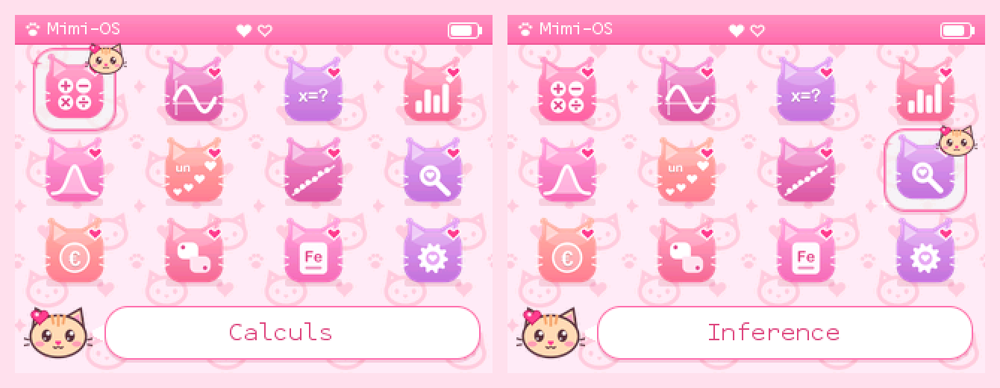
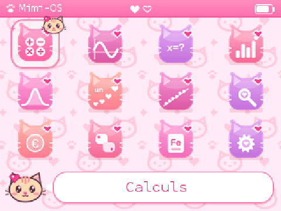
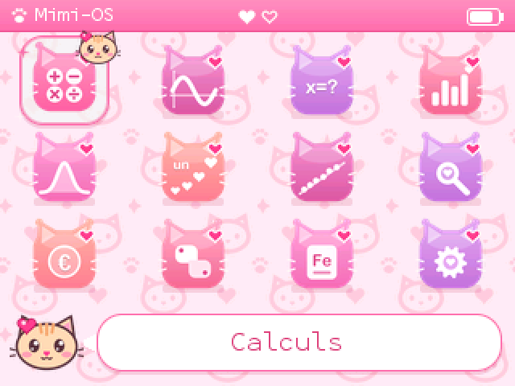
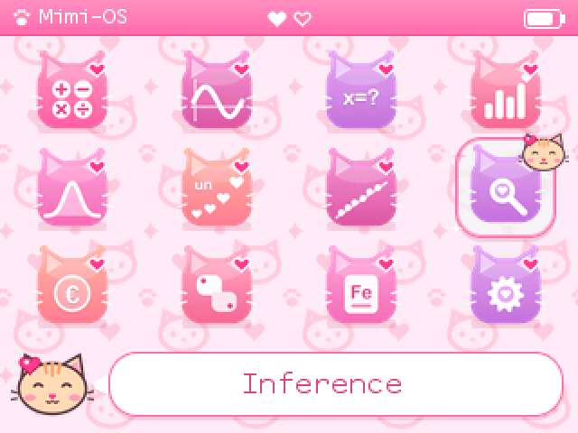
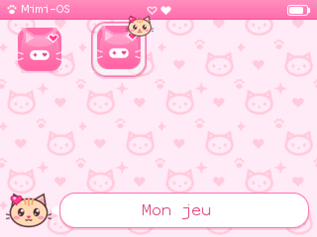

# Mimi-OS : ta NumWorks en mode kawaii tout rose

**Mimi-OS habille la calculatrice NumWorks (n0110, n0115 ou n0120) en rose
kawaii** : un écran d'accueil plein de chatons, des icônes en forme de tête de
chat, et **Mimi**, une petite chatonne abricot avec sa barrette en cœur, qui
sert de **curseur** : elle se pose sur l'appli choisie, saute de case en case
et cligne des yeux. Toutes les applis de la calculatrice passent au rose
(barres de titre, sélections, fonds, courbes).



<p align="center"></p>

> Captures prises dans le simulateur (batterie affichée à 82 %). Sur la
> calculatrice, tes jeux `.nwa` gardent leur propre icône, dans un cadre rose.

## L'écran d'accueil

- **Fond d'écran** rose à motifs : têtes de chatons, cœurs, pattes et
  étoiles.
- **Icônes chatons** : chaque appli est une tuile bonbon avec des oreilles de
  chat, des moustaches et la barrette en cœur de Mimi, et le symbole de
  l'appli dessus (Calculs, Fonctions, Python, Statistiques, Probabilités,
  Équations, Suites, Régressions, Éléments, Inférence, Finance, Paramètres).
- **Le curseur Mimi** : la tête de Mimi se pose sur le coin de l'appli
  choisie, flotte doucement, **glisse** jusqu'à la nouvelle appli quand tu te
  déplaces et **cligne des yeux** de temps en temps. L'appli choisie rebondit
  sur un halo blanc avec des étoiles qui scintillent. Quand tu ouvres une
  appli, Mimi fait un petit bond.
- **La bulle de Mimi** : en bas, la grande Mimi dit le nom de l'appli
  choisie.
- **Barre d'état** rose : patte, « Mimi-OS », un cœur par page, batterie
  (un petit cœur quand elle charge).
- **Pages** : 12 applis par page, les jeux `.nwa` sur les pages suivantes.

| Accueil | Curseur Mimi | Clin d'œil | Jeux |
| --- | --- | --- | --- |
|  |  |  |  |

## Le thème rose partout

Les couleurs de la calculatrice sont remplacées par des roses : barre de
titre, cellules sélectionnées, onglets, interrupteurs, fonds des listes,
curseur de texte, courbes du grapheur. Les couleurs des données (courbes
multiples, statistiques) restent distinctes pour qu'on s'y retrouve.

## Commandes

| Touche | Accueil |
| --- | --- |
| Flèches | déplacer Mimi (Bas sur la dernière ligne : page suivante) |
| OK ou EXE | ouvrir l'appli |
| 1 à 9 | choisir l'appli n (deux fois : l'ouvrir), 0 : Paramètres |
| Retour ou Home | revenir à la première appli |

## Installation

### 1. Obtenir Mimi-OS

Depuis juillet 2021, le code d'Epsilon (le logiciel de la NumWorks) n'est plus
sous licence libre. Mimi-OS ne publie donc **aucun code ni aucun firmware de
NumWorks** : seulement un **patch** (`patches/mimi-os-epsilon.patch`) et son
propre code. Le firmware se compile à partir des sources officielles de
NumWorks, dans ton compte GitHub ou sur ton Mac.

**Sans rien compiler (Mac ou Windows)**

1. En haut de cette page : **Use this template** > **Create a new
   repository**, coche **Private** (obligatoire : la compilation refuse de
   tourner dans un dépôt public, pour que le firmware ne soit pas
   téléchargeable par tous).
2. Facultatif : ajoute tes jeux `.nwa` dans le dossier `games/` de ta copie
   privée (*Add file* > *Upload files*).
3. Dans ta copie : onglet **Actions** > **Build Mimi-OS** > **Run workflow**.
4. Environ 30 minutes plus tard (un firmware par modèle), en bas de la page
   de la compilation, télécharge **Mimi-OS-Mac** ou **Mimi-OS-Windows** et
   décompresse-le (deux fois pour la version Mac : GitHub met le zip dans un
   zip).

**En compilant sur ton Mac**

```bash
brew install make dfu-util libusb
brew install --cask gcc-arm-embedded
git clone https://github.com/derim00/mimi-os.git && cd mimi-os
./scripts/build-firmware.sh
```

Le script télécharge Epsilon au commit indiqué dans `EPSILON_COMMIT`,
applique le patch, compile, prépare les jeux de `games/` et remplit le
dossier `installer/`.

### 2. Installer sur la calculatrice

**Sur Mac**

1. Une seule fois : `brew install libusb dfu-util` (et
   `brew install --cask gcc-arm-embedded` pour ajouter d'autres jeux).
2. Double-clique sur **`Installer Mimi-OS.command`** (la première fois :
   clic droit > **Ouvrir**). La page de l'installateur s'ouvre
   (http://127.0.0.1:8776).

**Sur Windows** (rien à installer : ni Python, ni pilote)

1. Décompresse **Mimi-OS-Windows** (clic droit > *Extraire tout*).
2. Double-clique sur **`Installer Mimi-OS.exe`** (si SmartScreen s'affiche :
   *Informations complémentaires* > *Exécuter quand même*). Laisse la
   fenêtre noire ouverte, ferme-la à la fin pour quitter.

**Ensuite, sur les deux**

3. Branche la calculatrice en USB et appuie sur **Reset** au dos : elle
   redémarre sur le système officiel.
4. Quand le voyant passe au vert, glisse tes jeux `.nwa` dans la page si tu
   veux, puis clique sur **Installer Mimi-OS**.

Seul le **slot B** est écrit : le système officiel (slot A) n'est jamais
modifié.

## À savoir

- **Calculatrice** : NumWorks **n0110**, **n0115** ou **n0120**, logiciel
  officiel **26.4.0** dans le slot A. L'installateur choisit tout seul le
  firmware du modèle branché.
- **Un seul système dans le slot B** : Mimi-OS remplace iOS-OS, Wii U-OS,
  Windows-OS, Switch-OS, PSP-OS… (et inversement). Les installateurs peuvent
  tourner en même temps (Mimi-OS utilise le port 8776).
- **Après un Reset**, la calculatrice revient sur le système officiel : il
  suffit de relancer l'installation.
- **Accents** : la police de la NumWorks n'a pas de lettres accentuées ; les
  noms s'affichent sans accents.
- **Home et On/Off** : le correctif du plantage Home / On-Off de Windows-OS
  est repris. Home ramène toujours à l'écran d'accueil.
- **Jeux** : seulement des applis `.nwa` dont tu as le droit de te servir, et
  uniquement dans ta copie privée : jamais dans un dépôt public.

## Comment c'est fait

| Fichier (dans le patch) | Rôle |
| --- | --- |
| `apps/home/mimi/shell.cpp` | écran d'accueil : fond à motifs, tuiles, curseur Mimi (glissé, flottement, clin d'œil, bond), bulle, barre d'état, pages |
| `apps/home/mimi/gfx.cpp` | rendu par bandes en RAM (repris d'iOS-OS), images avec transparence, texte, formes arrondies |
| `apps/home/mimi/gen_icons.py` | dessine Mimi, les icônes chatons, les cœurs et le fond d'écran dans `mimi_icons.h` |
| `escher/include/escher/palette.h`, `theme/light_theme.h` | le thème rose de toute la calculatrice |
| `escher/src/run_loop.cpp` | animations : l'appli d'accueil peut demander une image toutes les 40 ms |
| `scripts/photos.py` | transforme la séance photo du simulateur (`MIMI_SHOTS=dossier`) en PNG et GIF |

## Licence

Le code de Mimi-OS est sous licence **CC BY-NC-SA 4.0** (voir `LICENSE`).
Epsilon reste la propriété de NumWorks et n'est pas inclus dans ce dépôt.
Mimi est un personnage original créé pour ce projet ; les icônes et le fond
d'écran sont des dessins originaux. Mimi-OS est un projet de fan, sans lien
avec NumWorks.
